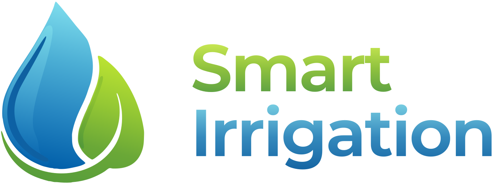

  

**Waters your garden from Home Assistant, putting back the water that sun, heat and wind took from the soil.**

Smart Irrigation works out, zone by zone, how much water your plants lost to evaporation and got back from the rain, and waters the difference. No fixed fifteen minutes, no watering the day after a storm, no guessing in a heatwave. Then it runs the watering itself, as much of it as you want it to: from a duration for your own automation, to programs, schedules and pumps.

It is the official Smart Irrigation integration for Home Assistant, available by default in [HACS](https://hacs.xyz).

  

## Two ways to use it

You choose one in **Settings › General**, under **What Smart Irrigation does**. The setup assistant asks too.

1. **Calculate only: it calculates, you water.** Each zone gets a duration, a water balance and the reasons behind them, as entities and events. Your own automation, a [blueprint for your controller](usage-controllers.md) (Rain Bird, Hydrawise, Rachio, OpenSprinkler, B-hyve, ESPHome), or Irrigation Unlimited does the watering. This is the choice of a new installation.
2. **Calculate and water: it runs your whole irrigation.** Smart Irrigation opens the valves itself, with [programs](usage-full-controller.md) of ordered steps, schedules ("done by sunrise", every other day, only in summer, after another program), cycle and soak so clay takes the water in, pumps and main valves, a watchdog for a valve left open, and a planning of what will run and why. The water actually delivered is credited to each zone. It can [import an Irrigation Unlimited configuration](usage-from-irrigation-unlimited.md).

The third choice, **Stop everything**, calculates and waters nothing, for the winter.

## What it does

- **It measures instead of guessing.** Each zone keeps a water balance in millimetres: evaporation out, rain in. When the balance says the soil is short, the zone waters exactly that much back, and not a drop more.
- **It uses the science, not a rule of thumb.** Evapotranspiration comes from the FAO-56 Penman-Monteith equation, the reference method in agronomy, computed hour by hour or day by day, from your own sensors, a weather service, any weather integration of Home Assistant, or a mix.
- **It says why.** Every calculation shows its work: what was read, what was computed, and what it decided. The Home page shows the next watering, what is watering now, and whether a run would be held back and on what numbers.
- **It does not water when it should not.** Rain in the forecast, a rain sensor, frost, wind, or soil that is already wet: any of these can hold a run back, and each schedule of a program can choose which apply to it.
- **It knows a greenhouse.** Under glass the sky is not what reaches the plant. A lux sensor inside answers it, and without one the glass dims the sun.
- **It is easy to start and deep when you need it.** A panel built with Home Assistant's own components, in a standard mode with a setup assistant that creates your first zone, an advanced mode that opens every setting, and **Edit in YAML** for the few options a power user wants.
- **It fits into Home Assistant.** A `valve` entity per zone for dashboards and voice assistants, sensors, buttons and events for your own automations, and [a dashboard card](usage-card.md) that shows where each zone stands and can water one on demand.
- **It speaks your language.** The panel and everything Home Assistant shows for it come in 20 languages. Most were machine-translated and wait for a native speaker: [you can correct them on Weblate](help.md#help-translate), in the browser.

  
  

## How it works, in one paragraph

Water leaves the soil by evaporation and through the leaves. How fast depends on the sun, the temperature, the humidity and the wind, and that is what the FAO-56 equation computes from your weather data. Smart Irrigation adds that loss to a per-zone water balance, subtracts the rain, and when the water balance is short by more than the threshold you set, it converts the missing millimetres into a run time from the zone's own area and flow. After the run, the water balance goes back to zero and the cycle starts again. The [how it works](how-it-works.md) page tells it properly, and the [calculation explanation](usage-info.md) on each zone shows the numbers of the day.

## What you need

- **Home Assistant**, and a way to turn your watering on and off from it.
- **Weather data**, which can be your own sensors, or a weather service: Open-Meteo needs no account, OpenWeatherMap and Pirate Weather need a free API key.
- **A few minutes.** The setup assistant asks what it needs, one question at a time, and creates the first zone for you.

Smart Irrigation opens your valves itself only if you choose **Calculate and water**. Otherwise it calculates, and you decide what listens.

!!! warning "Use this integration at your own risk"

    We assume no responsibility for any inconvenience caused by using it. Always use common sense before deciding to irrigate on the numbers it provides: watering during heavy rain can cause flooding.

## Start here

- **[Never done any of this?](getting-started-from-scratch.md)** The whole path in half an hour: a machine, a valve, Home Assistant, a zone that waters itself.
- **[Install it](installation.md)**, which is a HACS download and a restart.
- Prefer to read first? **[How it works](how-it-works.md)** and **[which weather service to use](weather-services.md)**.
- Rather watch? The [official tutorial videos (English)](https://youtube.com/playlist?list=PLUHIAUPJHMiakbda92--fgb6A0hFReAo7&si=82Xc6mHoLDwFBfCP), and a [community tutorial in German](https://youtu.be/1AYLuIs7_Pw).
- Something not right? [Troubleshooting](usage-troubleshooting.md), the [discussions](https://github.com/altmenorg/HAsmartirrigation/discussions), or an [issue](https://github.com/altmenorg/HAsmartirrigation/issues) with a diagnostics file.

---

## Attribution

**Smart Irrigation** was created by [Jeroen ter Heerdt](https://github.com/jeroenterheerdt) and its contributors. All credit for the underlying evapotranspiration calculation and the original design goes to them. He transferred the project in June 2026, and this is where the official Smart Irrigation is maintained and released.

The integration is distributed under the [MIT License](https://github.com/altmenorg/HAsmartirrigation/blob/master/LICENSE), © Jeroen ter Heerdt and contributors.
